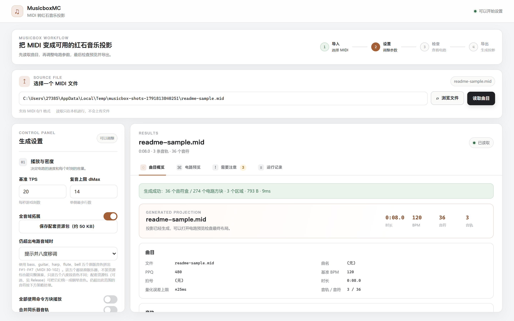
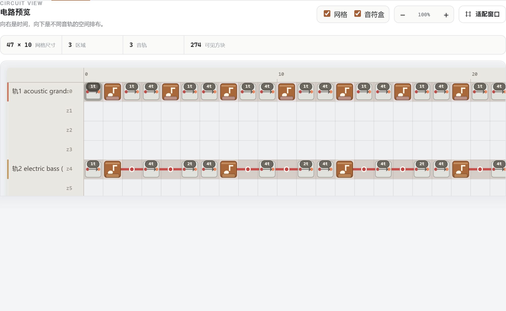

# MusicboxMC

<p align="center">
  
</p>

<p align="center">
  <strong>把 MIDI 文件变成 Minecraft 红石音乐投影。</strong><br />
  导入乐曲 → 点击生成 → 粘贴 <code>.litematic</code> → 接通红石，开始演奏。
</p>

<p align="center">
  <strong>简体中文</strong>　·　<a href="docs/README.en.md">English</a>
</p>

<p align="center">
  <a href="https://github.com/xingtuan416/MusicboxMC/releases/latest"></a>
  <a href="https://github.com/xingtuan416/MusicboxMC/actions/workflows/ci.yml"></a>
  <a href="LICENSE"></a>
</p>

<p align="center">
  官网：<a href="https://xingtuan.dpdns.org/">xingtuan.dpdns.org</a>
</p>



MusicboxMC 读取 MIDI 文件，编译成红石电路，再写成 Litematica 的 `.litematic`
投影。粘贴到世界里，在起点接上红石信号，乐曲就会演奏。

难点从来不是"把音符盒摆出来"，而是**时序**。生成器把每个音符量化到红石刻网格，
算出承担组间间隔的中继器档位，再用红石线补齐各轨位置——红石线不产生延迟，所以
补齐不改变任何一个音的触发时刻。这样多条音轨才能在长曲中始终对齐，而不是越走越散。

## 下载

Windows x64。两个文件任选其一，均来自
[最新发布](https://github.com/xingtuan416/MusicboxMC/releases/latest)。

| 文件                                     | 说明                                                            |
| ---------------------------------------- | --------------------------------------------------------------- |
| `MusicboxMC-Setup-<version>-win-x64.exe` | 安装包。可选安装目录，创建开始菜单与桌面快捷方式。              |
| `MusicboxMC-<version>-win-x64.zip`       | 便携版。解压后直接运行 `MusicboxMC.exe`，不在目录外写任何东西。 |

`<version>` 是最新发布版本；实际文件名以 Releases 页面为准。

生成的是 Litematica **litematic v6**（`MinecraftDataVersion` 3700，对应 1.20.4）。
能否加载取决于所用 Litematica 是否支持读取 v6，并由 DataFixer 升级旧数据版本；
已在 Minecraft Java **1.17.1 – 26.3** 的对应 Litematica 组合中实机验证。
**1.16.5 及以下不可用。** 需要
[Litematica](https://masa.dy.fi/mcmods/client_mods/?mod=litematica) 模组来粘贴生成的投影。

## 快速上手

1. **导入。** 打开程序，选择 `.mid` / `.midi` 文件。曲名、BPM、拍号、音轨与音符数会立即显示。
2. **调整。** 大多数曲子不需要改任何设置。真正影响结果的只有 `dMax`
   （单条分线列可以有多宽）和"超出音域的音符怎么处理"。
3. **检查，再生成。** 在系统「另存为」窗口选好文件夹和文件名，再开始检查。程序会把问题列在**检查结果**页，
   并画出**红石布线**：一行 = 一个实际 Z 行，一列 = 一格 X，时间向右推进。它是一块
   **视口**而不是整张图——拖拽或滚轮平移，格子固定在一个可读的尺寸。确认无误后点
   **生成投影**，文件这时才写入磁盘。

   

4. **粘贴。** 把 `.litematic` 放进 `.minecraft/schematics/`，在游戏里用 Litematica
   加载并放置。红石模式请按完成页的坐标接线，由同一个按钮在同一游戏刻给所有独立供电点送电。

生成之后如果有什么需要留意的，**检查结果**页会逐条列出。每条能定位的警告都带一个
**在红石布线里定位**按钮，点一下就会跳到红石布线里对应的那一格并把它圈出来，不用自己去找。

## 核心特性

**内联式主线。** 中继器与音符盒共用一行，不像传统做法那样分层布线，因此没有多余的
红石线要走，也少了错位的余地。音符盒**正上方必须是空气**才发声，这是所有东西必须
挤在同一层的原因。

**和弦尽量省。** 三个音以内只用一个中继器：内联那个音符盒会点亮紧邻的两格——只导
一跳——不需要额外的线和中继器。四个音以上改走分支行，每个额外音各配一个中继器，
整组仍在同一个红石刻触发。

**多轨始终对齐。** 稀疏轨和密集轨每拍占用的格数不同，放任不管会在长曲中拉开几百格，
听起来就不再像同一次演奏。所有音轨都跟随一条共享的"曲中时刻 → X"参考线，用红石线
向前补齐，而补齐不改变任何音的触发时刻。

**可选并轨。** 相同乐器的音轨可以合并到一条主线。还有一个更严格的强制模式：全曲
所有音轨合成**一条**连通主线（不同乐器可以混在同一条线上），并在写文件前遍历
**实际方块连接**做校验——信号可达性、音符触发时刻、中继器锁定、支撑方块——结果
不成立就直接拒绝生成。

## 两种播放后端

默认后端生成音符盒红石电路，就是上面截图里的东西，也是你在世界里搭建时想要的。

此外有一个可选**命令方块播放**后端。它完全不放置音符盒、红石线或中继器：每个音符
变成一条 `playsound` 命令，在所有在线玩家的当前位置发声，按游戏刻量化。这解决了
电路绕不开的两件事——必须靠近才能听到，以及复音数受信号强度限制——代价是需要命令
方块，并且会给服务器带来负载。

值得一提的是，最直白的实现根本不可扩展：一个音符一个命令方块，会让一首 46291 音的
曲子变成 46308 个方块、348 KB 投影，而且命令链每个游戏刻都要把这些全部走一遍。本实现
把时刻表存成一张小表，再用**数量有界的复用命令**回放，同一首曲子只有 798 个方块、
链长 764、**27.9 KB**。

使用条件与已知限制见 [docs/command-playback.md](docs/command-playback.md)，长曲目请先读它。

## 乐器、音域，以及资源包是干什么的

单个音符盒只有两个八度。本项目支持 **16 种经典音符盒乐器**，其中 13 种用于旋律映射，另有底鼓、军鼓和踩镲，
每种从自己的 F# 锚点起算、覆盖两个八度；完整表见
[多乐器设计](docs/multi-instrument.md)。

**Minecraft 没有钢琴音色。** 泥土等大多数方块下面是 **harp（竖琴）** 采样，它最接近钢琴，
教程里常被当作钢琴；本项目的「钢琴音色」指的是 harp 采样加上配套资源包的五段替换。

界面有两种模式：

- **扩展竖琴音域（默认）**：钢琴/未识别轨用 bass、guitar、harp、flute、bell 五个槽拼出
  **F#1–F#7**；其它乐器保持原版；原生落在被占用的五种上的轨，换成相近的空闲音色
  （bass→didgeridoo、guitar→banjo、flute→bit、bell→chime）。
- **原版乐器**：每条轨跟随 MIDI 乐器，各两个八度；钢琴轨用 harp，**F#3–F#5**。

鼓通道按 MIDI 音符和轨道名逐音匹配。其他通道按 GM 音色 → 轨道名 → 竖琴识别。选轨页会显示每条轨的识别结果。

配套资源包把扩展模式五个槽的声音事件替换成钢琴采样，让整个音域听起来像同一架钢琴。
**它是可选的**，装与不装生成的投影相同；**原版乐器模式不建议安装**，否则原生
bass/guitar/flute/bell 也会被换成钢琴。

资源包**已内置在应用里**。导出位置这一步有「保存（约 50 KB）」按钮。
完成页可点「获取资源包」。当成品使用扩展钢琴的外侧音色槽时，也会提示保存。把它放进 `.minecraft/resourcepacks/` 并在游戏里启用即可。
想直接下载的话，
[Release 页面](https://github.com/xingtuan416/MusicboxMC/releases/latest/download/MusicboxMC-piano-pack-1.20.4.zip)
也有。`v0.4.5` 的发行附件仍含旧版音色映射。

`npm run resourcepack:check` 校验内置包。加 `-- <pack.zip>` 可校验指定文件，要求 1.20.4 的资源包格式与五个音色映射同时匹配。

## 与 Note Block Studio 的区别

这是两个用途不同的工具，值得说清楚你要的是哪一个。

|          | MusicboxMC                 | Note Block Studio               |
| -------- | -------------------------- | ------------------------------- |
| 定位     | 把 MIDI 转成投影           | 编写与编辑音符盒音乐            |
| 输入     | `.mid` / `.midi`           | 自己的 `.nbs` 工程，或导入 MIDI |
| 输出     | `.litematic`，可直接粘贴   | `.nbs`，再经其它工具导出        |
| 修改结果 | 不支持；改 MIDI 后重新生成 | 完整的钢琴卷帘编辑器            |
| 试听     | 没有，到游戏里听           | 内置                            |
| 成熟度   | 新                         | 多年沉淀，社区庞大              |

如果你想编曲、逐音调整，或者想在搭建之前先听效果，用 Note Block Studio。
如果你手上已经有 MIDI、只想要电路，这个工具省掉编曲那一步。

## 从源码构建

需要 Node.js 26 或更高版本。

```bash
git clone https://github.com/xingtuan416/MusicboxMC.git
cd MusicboxMC
npm ci
npm test
npm start          # 先用 tsc 编译，然后启动 Electron
```

打包 Windows 产物需要 Windows 环境：

```bash
npm run dist       # NSIS 安装包 + 便携 zip，输出到 release/
npm run dist:dir   # 只出免安装目录，用于快速验证
```

其余检查为 `npm run lint`、`npm run typecheck`、`npm run build`；这三项加 `npm test`
就是 CI 全部会跑的内容。

`src/core/` 下是纯逻辑引擎，不依赖 Electron 也不依赖 DOM，因此可以直接在 Node 里运行
和测试。布局、时序、NBT 与 litematic 代码都在那里，想改电路生成方式的话从这里读起。

## 游戏内使用方法

1. 点击 **选择 MIDI 文件** 导入乐曲。
2. 在右侧控制面板调整参数（多数情况保持默认即可）。
3. 在系统「另存为」窗口选择投影文件，检查后点击 **生成投影**。
4. 把生成的文件放进 `.minecraft/schematics/`。
5. 安装 Litematica 并进入游戏，按 `M` 打开菜单加载投影并放置。
6. 红石模式按完成页的坐标给所有独立供电点同时送电。命令模式在开启命令方块的世界中按 Start / Restart。
7. 若更改了基准 TPS，执行完成页显示的 `/tick rate` 命令以原速播放。

## 文档

- [文档索引](docs/README.md) —— 全部设计文档的入口
- [架构](docs/architecture.md) —— 分层、数据流、该改哪里
- [红石模型](docs/redstone-model.md) —— 拓扑、时序、对齐，以及**故意不做**的仿真
- [命令方块播放](docs/command-playback.md) —— 时刻表、命令链、预算与游戏内要求
- [Litematic 格式](docs/litematic-format.md) —— 位打包、索引顺序、区域规则
- [贡献指南](.github/CONTRIBUTING.md) · [更新日志](docs/CHANGELOG.md) · [安全策略](.github/SECURITY.md)

## 许可证

[GNU General Public License v3.0](LICENSE)。
