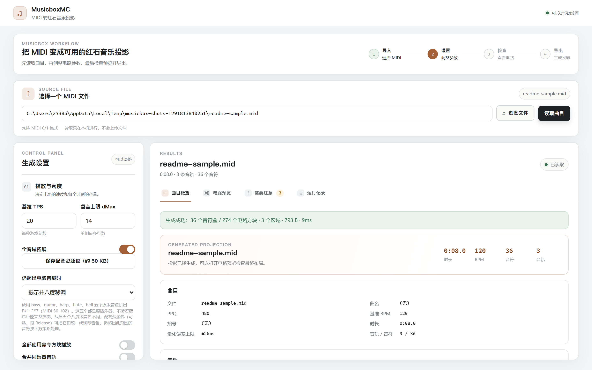
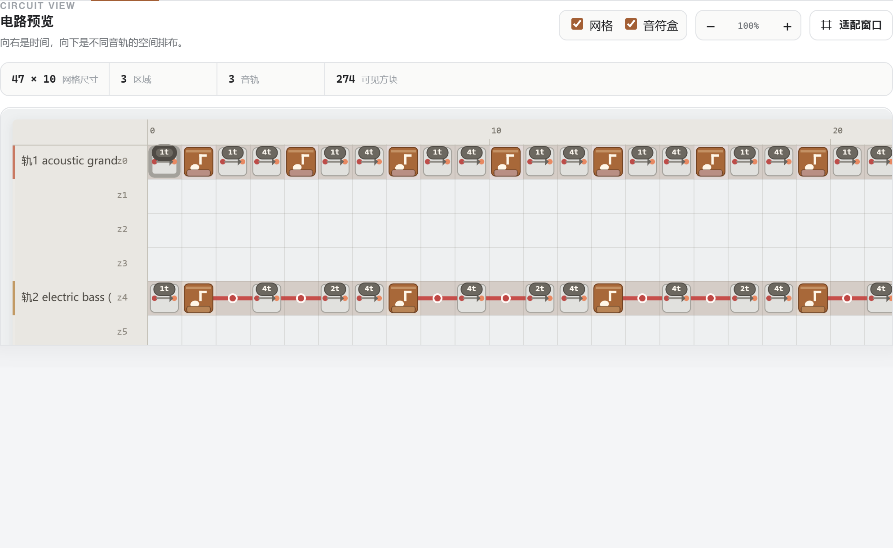

# MusicboxMC

<p align="center">
  
</p>

<p align="center">
  <strong>把 MIDI 文件变成 Minecraft 红石音乐投影。</strong><br />
  导入乐曲 → 点击生成 → 粘贴 <code>.litematic</code> → 接通红石，开始演奏。
</p>

<p align="center">
  <a href="https://github.com/xingtuan416/MusicboxMC/releases/tag/v0.1.0"></a>
  <a href="https://github.com/xingtuan416/MusicboxMC/actions/workflows/ci.yml"></a>
  <a href="LICENSE"></a>
</p>



MusicboxMC 读取 MIDI 文件，编译成红石电路，再写成 Litematica 的 `.litematic`
投影。粘贴到世界里，在起点接上红石信号，乐曲就会演奏。

难点从来不是"把音符盒摆出来"，而是**时序**。生成器把每个音符量化到红石刻网格，
算出承担组间间隔的中继器档位，再用红石线补齐各轨位置——红石线不产生延迟，所以
补齐不改变任何一个音的触发时刻。这样多条音轨才能在长曲中始终对齐，而不是越走越散。

## 下载

Windows x64。两个文件任选其一，均来自
[最新发布](https://github.com/xingtuan416/MusicboxMC/releases/tag/v0.1.0)。

| 文件                                 | 说明                                                            |
| ------------------------------------ | --------------------------------------------------------------- |
| `MusicboxMC-Setup-0.1.0-win-x64.exe` | 安装包。可选安装目录，创建开始菜单与桌面快捷方式。              |
| `MusicboxMC-0.1.0-win-x64.zip`       | 便携版。解压后直接运行 `MusicboxMC.exe`，不在目录外写任何东西。 |

另外需要 Minecraft Java 版 **1.20.4**，以及
[Litematica](https://masa.dy.fi/mcmods/client_mods/?mod=litematica) 模组来粘贴生成的投影。

## 快速上手

1. **导入。** 打开程序，选择 `.mid` / `.midi` 文件。曲名、BPM、拍号、音轨与音符数会立即显示。
2. **调整。** 大多数曲子不需要改任何设置。真正影响结果的只有 `dMax`
   （单条分线列可以有多宽）和"超出音域的音符怎么处理"。
3. **生成。** 满意之前可以先看电路预览：**一行 = 一个实际 Z 行，一列 = 一格 X**，时间向右推进。

   

4. **粘贴。** 把 `.litematic` 放进 `.minecraft/schematics/`，在游戏里用 Litematica
   加载并放置，然后在电路起点接电。

## 核心特性

**内联式主线。** 中继器与音符盒共用一行，不像传统做法那样分层布线，因此没有多余的
红石线要走，也少了错位的余地。音符盒**正上方必须是空气**才发声，这是所有东西必须
挤在同一层的原因。

**和弦尽量省。** 三个音以内只用一个中继器：内联那个音符盒会点亮紧邻的两格——只导
一跳——不需要额外的线和中继器。四个音以上改走分支行，每个额外音各配一个中继器，
整组仍在同一个红石刻触发。

**多轨始终对齐。** 稀疏轨和密集轨每拍占用的格数不同，放任不管会在长曲中拉开几百格，
听起来就不再像同一次演奏。所有音轨都跟随一条共享的"曲中时刻 → X"参考线，用红石线
向前补齐，而补齐不改变任何音的触发时刻。

**可选并轨。** 相同乐器的音轨可以合并到一条主线。还有一个更严格的强制模式：每种
乐器一条连通主线，并在写文件前遍历**实际方块连接**做校验——信号可达性、音符触发
时刻、中继器锁定、支撑方块——结果不成立就直接拒绝生成。

## 两种播放后端

默认后端生成音符盒红石电路，就是上面截图里的东西，也是你在世界里搭建时想要的。

此外有一个可选**命令方块播放**后端。它完全不放置音符盒、红石线或中继器：每个音符
变成一条 `playsound` 命令，在所有在线玩家的当前位置发声，按游戏刻量化。这解决了
电路绕不开的两件事——必须靠近才能听到，以及复音数受信号强度限制——代价是需要命令
方块，并且会给服务器带来负载。

值得一提的是，最直白的实现根本不可扩展：一个音符一个命令方块，会让一首 46291 音的
曲子变成 46308 个方块、348 KB 投影，而且命令链每个游戏刻都要把这些全部走一遍。本实现
把时刻表存成一张小表，再用**数量有界的复用命令**回放，同一首曲子只有 798 个方块、
链长 764、**27.9 KB**。

使用条件与已知限制见 [docs/command-playback.md](docs/command-playback.md)，长曲目请先读它。

## 音域，以及资源包是干什么的

单个音符盒只有两个八度。**原版**的五个音符盒乐器——bass / guitar / harp / flute / bell
——合起来覆盖 **F#1 到 F#7**（MIDI 30–102），本生成器用的就是这个跨度。

**这五个都是原版乐器，所以生成的投影不装任何资源包也能正常演奏。** 区别只在于五个
八度段的**音色不同**，旋律跨越多个八度时听得出来。

另有一个配套资源包，把这五个声音事件替换成钢琴采样，让整个音域听起来是同一架钢琴。
**它是可选的**：生成器不依赖它，装与不装生成的投影完全相同。

- [`MusicboxMC-piano-pack-1.20.4.zip`](https://github.com/xingtuan416/MusicboxMC/releases/download/v0.1.0/MusicboxMC-piano-pack-1.20.4.zip)
  （50 KB）—— 放进 `.minecraft/resourcepacks/` 并启用即可。

`npm run resourcepack:check <pack.zip>` 可以按生成器期望的映射校验任意资源包。

## 与 Note Block Studio 的区别

这是两个用途不同的工具，值得说清楚你要的是哪一个。

|          | MusicboxMC                 | Note Block Studio               |
| -------- | -------------------------- | ------------------------------- |
| 定位     | 把 MIDI 转成投影           | 编写与编辑音符盒音乐            |
| 输入     | `.mid` / `.midi`           | 自己的 `.nbs` 工程，或导入 MIDI |
| 输出     | `.litematic`，可直接粘贴   | `.nbs`，再经其它工具导出        |
| 修改结果 | 不支持；改 MIDI 后重新生成 | 完整的钢琴卷帘编辑器            |
| 试听     | 没有，到游戏里听           | 内置                            |
| 成熟度   | 新                         | 多年沉淀，社区庞大              |

如果你想编曲、逐音调整，或者想在搭建之前先听效果，用 Note Block Studio。
如果你手上已经有 MIDI、只想要电路，这个工具省掉编曲那一步。

## 从源码构建

需要 Node.js 20 或更高版本。

```bash
git clone https://github.com/xingtuan416/MusicboxMC.git
cd MusicboxMC
npm ci
npm test
npm start          # 先用 tsc 编译，然后启动 Electron
```

打包 Windows 产物需要 Windows 环境：

```bash
npm run dist       # NSIS 安装包 + 便携 zip，输出到 release/
npm run dist:dir   # 只出免安装目录，用于快速验证
```

其余检查为 `npm run lint`、`npm run typecheck`、`npm run build`；这三项加 `npm test`
就是 CI 全部会跑的内容。

`src/core/` 下是纯逻辑引擎，不依赖 Electron 也不依赖 DOM，因此可以直接在 Node 里运行
和测试。布局、时序、NBT 与 litematic 代码都在那里，想改电路生成方式的话从这里读起。

## 游戏内使用方法

1. 点击 **选择 MIDI 文件** 导入乐曲。
2. 在右侧控制面板调整参数（多数情况保持默认即可）。
3. 点击 **生成 .litematic 投影** 并选择保存位置。
4. 把生成的文件放进 `.minecraft/schematics/`。
5. 安装 Litematica 并进入游戏，按 `M` 打开菜单加载投影并放置。
6. 在主线起点的红石粉处接上拉杆或信号脉冲，开始演奏。

## 文档

- [架构](docs/architecture.md) —— 分层、数据流、该改哪里
- [红石模型](docs/redstone-model.md) —— 拓扑、时序、对齐，以及**故意不做**的仿真
- [命令方块播放](docs/command-playback.md) —— 时刻表、命令链、预算与游戏内要求
- [Litematic 格式](docs/litematic-format.md) —— 位打包、索引顺序、区域规则
- [贡献指南](CONTRIBUTING.md) · [更新日志](CHANGELOG.md) · [安全策略](SECURITY.md)

## 许可证

[GNU General Public License v3.0 或更高版本](LICENSE)。

---

<sub>English documentation: [README.md](README.md).</sub>
